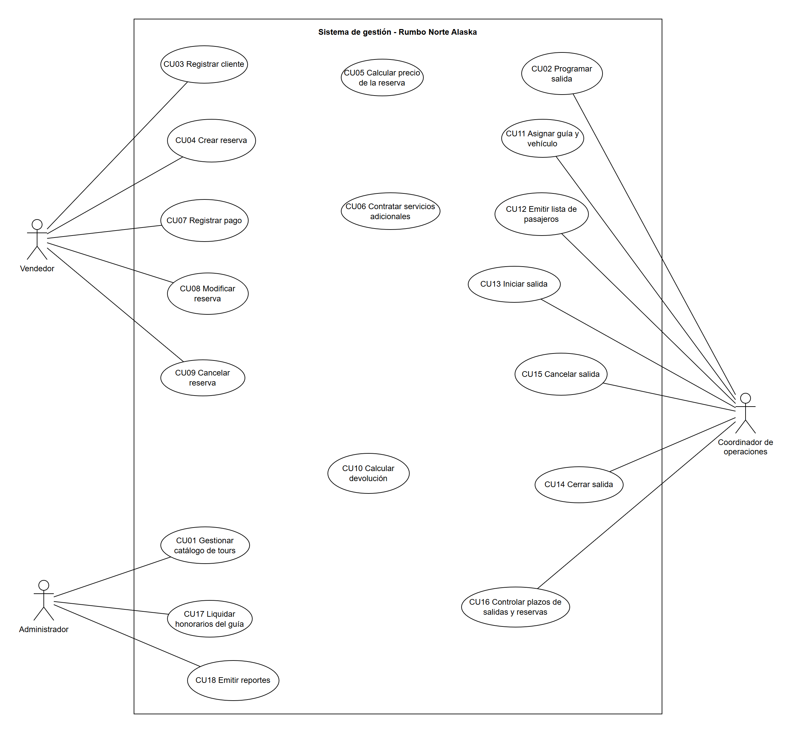
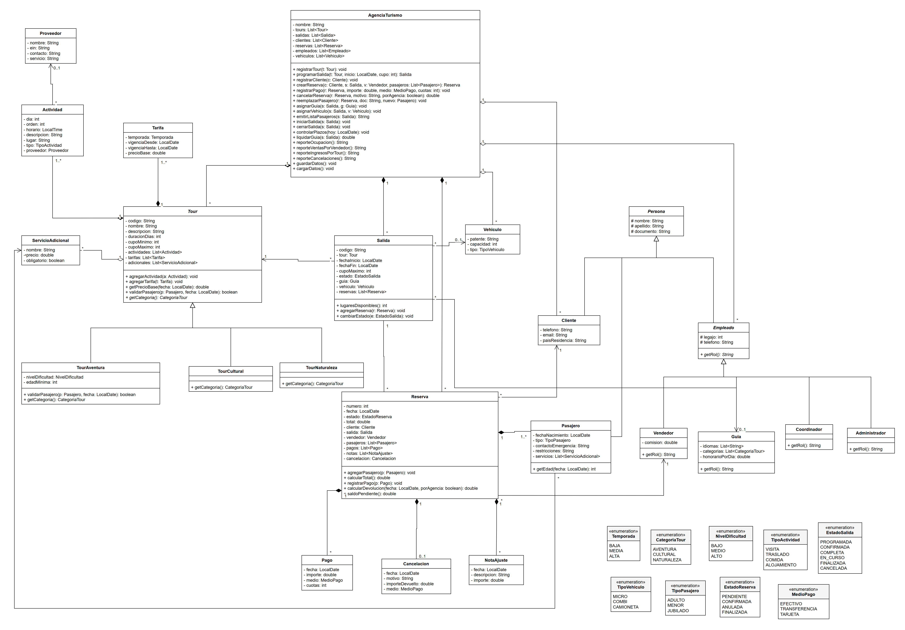
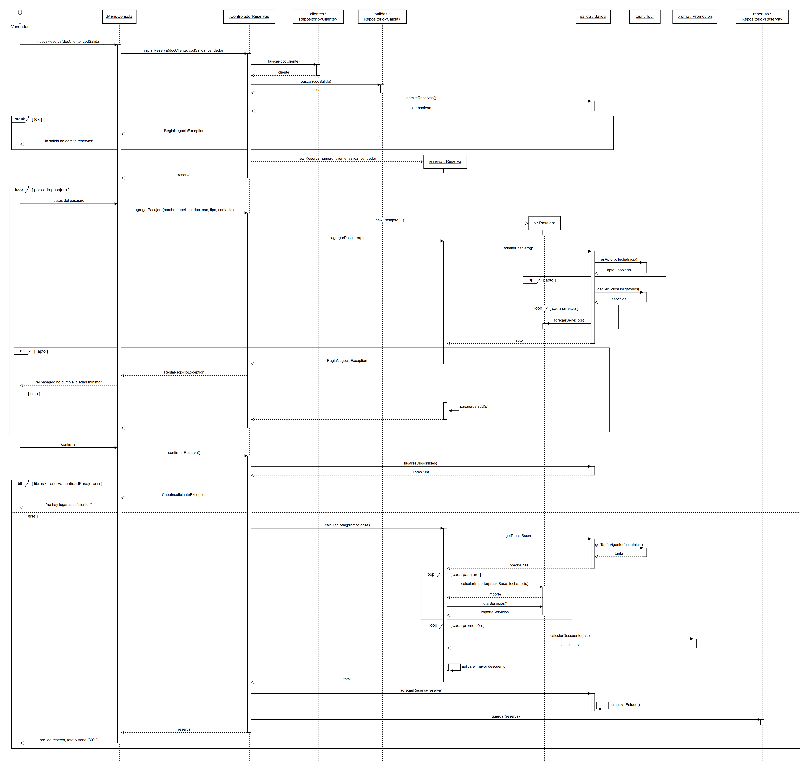
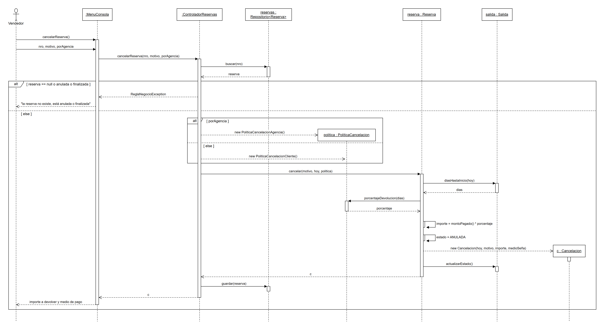

# Documento de diseño - Etapa 1

**Programación Orientada a Objetos - Trabajo Práctico Obligatorio**

Sistema de gestión para la agencia "Rumbo Norte Alaska"

- Propuesta elegida: B - Agencia de Turismo (adaptada a una agencia receptiva en Alaska, cambio de contexto aprobado por el docente).
- Integrantes: Joaquín Castellano Acuña, Juan Zeljkovich, Juan Pedro Sama.
- Repositorio: https://github.com/jpsam4/TrabajoPOO

## 1. Propuesta elegida y enunciado

Elegimos la Propuesta B (Agencia de Turismo). Con la aprobación del docente cambiamos el contexto: en vez de "Rumbo Sur" trabajamos con una agencia de turismo receptivo en Alaska. Los casos de uso mínimos y las reglas de negocio son los mismos de la propuesta.

La agencia "Rumbo Norte Alaska", con base en Anchorage, es una agencia de turismo receptivo que organiza tours y excursiones con salidas programadas por Alaska. Los tours pueden ser de aventura (kayak entre glaciares en Kenai Fjords, trekking en Denali, escalada en hielo en el glaciar Matanuska), culturales (ruta de la fiebre del oro en Skagway, herencia nativa de Alaska en Anchorage, historia del Iditarod) o de naturaleza (avistaje de osos en Katmai, ballenas en Juneau, auroras boreales en Fairbanks).

De cada tour se conoce el código, el nombre, la descripción, la duración en días, la categoría y el cupo mínimo y máximo. Los tours de aventura registran además un nivel de dificultad y una edad mínima. Cada tour tiene un itinerario formado por actividades (día, orden, horario, descripción y lugar). Algunas actividades incluyen servicios de terceros, como una comida, una noche de alojamiento en un lodge o un vuelo en hidroavión, que se contratan a proveedores, de quienes se registra el nombre, el EIN (número de identificación fiscal de EE.UU., equivalente al CUIT), el contacto y el servicio que prestan.

Cada tour tiene tarifas por temporada con una vigencia y un precio base por pasajero. La agencia programa salidas: cada una corresponde a un tour y tiene fecha de inicio, de fin, estado, un guía y un vehículo (patente, capacidad y tipo: micro, combi o camioneta).

El personal se compone de vendedores (con comisión), guías (idiomas, categorías habilitadas y honorario por día), un coordinador de operaciones y un administrador. Los clientes se registran con nombre, apellido, documento, teléfono, correo y país de residencia. Un cliente arma una reserva para una salida con un vendedor; la reserva incluye pasajeros con documento, fecha de nacimiento, tipo, contacto de emergencia y restricciones alimentarias o de salud. Se pueden contratar servicios adicionales por pasajero (excursiones opcionales, traslados al aeropuerto, seguro de viaje). El cliente paga con una seña y pagos posteriores; si cancela se registra la fecha, el motivo y el importe devuelto.

Al finalizar cada salida el coordinador la cierra y la agencia liquida los honorarios del guía. El administrador emite reportes de ocupación por salida, ventas por vendedor, ingresos por tour y cancelaciones. Se mantienen todas las reglas de negocio de la Propuesta B; solamente cambia el contexto (aprobado por el docente).

## 2. Análisis del enunciado

### 2.1 Actores

| Actor | Qué hace en el sistema |
|-------|------------------------|
| Vendedor | Registra clientes, arma reservas con sus pasajeros, contrata adicionales, registra pagos, modifica y cancela reservas. |
| Coordinador de operaciones | Programa salidas, asigna guía y vehículo, emite la lista de pasajeros, inicia, cierra y cancela salidas y ejecuta el control diario de plazos. |
| Administrador | Mantiene el catálogo de tours (itinerario, tarifas, adicionales y proveedores), liquida los honorarios de los guías y emite los reportes. |

### 2.2 Requerimientos funcionales

- RF01. Dar de alta y modificar tours con su itinerario de actividades, tarifas por temporada, servicios adicionales y proveedores.
- RF02. Programar salidas de un tour con fecha de inicio y cupo.
- RF03. Registrar clientes.
- RF04. Crear reservas para una salida con uno o más pasajeros.
- RF05. Calcular el precio de la reserva según tipo de pasajero, temporada, promociones y adicionales.
- RF06. Contratar servicios adicionales por pasajero.
- RF07. Registrar la seña y los pagos del saldo, en uno o varios pagos y con distintos medios.
- RF08. Modificar reservas (reemplazo de pasajeros y agregado de adicionales).
- RF09. Cancelar reservas aplicando la política de cancelación y registrar la devolución.
- RF10. Asignar guía y vehículo a una salida.
- RF11. Emitir la lista de pasajeros de una salida.
- RF12. Iniciar, cerrar y cancelar salidas.
- RF13. Controlar los plazos: cancelar salidas sin cupo mínimo a 7 días y anular reservas con saldo impago a 10 días.
- RF14. Liquidar los honorarios del guía por salida finalizada.
- RF15. Emitir reportes de ocupación por salida, ventas por vendedor, ingresos por tour y cancelaciones.
- RF16. Guardar y recuperar toda la información en archivos para que se conserve entre ejecuciones.

### 2.3 Reglas de negocio

**Tours y salidas**

- RN01. Un tour tiene un itinerario de actividades ordenadas por día y orden (visita, traslado, comida, alojamiento). Puede ser de un día o de varios.
- RN02. Hay tres categorías: aventura, cultural y naturaleza. La de aventura exige una edad mínima y tiene un nivel de dificultad.
- RN03. Una salida es una realización de un tour en una fecha, con cupo máximo, guía y vehículo. Estados: programada, confirmada, completa, en curso, finalizada y cancelada.
- RN04. La salida se confirma al alcanzar el cupo mínimo. Si 7 días antes de la fecha no lo alcanza, se cancela y se devuelve el 100 % de lo pagado.
- RN05. Al llegar al cupo máximo la salida pasa a "completa" y no admite nuevas reservas.
- RN06. Un guía no puede tener dos salidas superpuestas y solo guía tours de categorías para las que está habilitado.
- RN07. La capacidad del vehículo no puede ser menor que el cupo de la salida.

**Reservas y precios**

- RN08. Una reserva pertenece a un cliente titular y a una salida, e incluye uno o más pasajeros. Ocupa tantos lugares como pasajeros tenga.
- RN09. La tarifa base depende de la temporada (baja, media o alta). Adulto paga 100 %, menor de 12 años 60 %, menor de 3 años no paga pero se registra. Jubilados: 10 % de descuento.
- RN10. Promociones: reserva anticipada (15 % si se reserva con más de 60 días) y grupo (10 % para 6 o más pasajeros). No se acumulan: se aplica la más favorable.
- RN11. Los servicios adicionales se suman al precio por pasajero. El seguro de viaje es obligatorio en los tours de aventura.
- RN12. La reserva se confirma al pagar una seña del 30 %. El saldo se cancela hasta 10 días antes de la salida; si no, la reserva se anula y los lugares vuelven al cupo.
- RN13. Los pagos pueden hacerse en cuotas y con distintos medios (efectivo, transferencia, tarjeta). Tarjeta en cuotas tiene un recargo del 7 %.

**Cancelaciones**

- RN14. Devolución según anticipación: 30 días o más, 90 %; entre 29 y 15 días, 50 %; entre 14 y 7 días, 20 %; menos de 7 días, sin devolución.
- RN15. Si la cancelación la provoca la agencia, se devuelve siempre el 100 %.
- RN16. Un pasajero puede reemplazarse por otro hasta 3 días antes sin cargo, si cumple las condiciones del tour.

**Operación y liquidaciones**

- RN17. Antes de la salida el coordinador emite la lista de pasajeros con documento y contacto de emergencia. No se puede iniciar una salida sin esa lista ni sin guía.
- RN18. El guía cobra por salida finalizada un monto fijo por día más el 5 % de las ventas de adicionales de esa salida.
- RN19. Una reserva pagada no se elimina: las correcciones se registran como notas de ajuste.

### 2.4 Supuestos

Lo que el enunciado no aclara lo resolvimos así:

- S01. Contexto: agencia receptiva en Alaska. Los importes se manejan en dólares estadounidenses (USD). Del proveedor se registra el EIN en lugar del CUIT.
- S02. Los clientes no usan el sistema: todo lo carga el vendedor. Tampoco el guía; recibe la lista de pasajeros que emite el coordinador.
- S03. Es una aplicación de un solo usuario a la vez. No hay login: al iniciar, el menú pide elegir el rol (vendedor, coordinador o administrador) y, si es vendedor, su legajo.
- S04. Personal y vehículos se cargan una vez desde un archivo de datos iniciales; no se pidió un caso de uso para administrarlos.
- S05. Temporadas en Alaska: alta del 15/06 al 31/08, media de mayo al 14/06 y septiembre, baja de octubre a abril (temporada de auroras). La tarifa que se usa es la que está vigente en la fecha de inicio de la salida.
- S06. La edad del pasajero se calcula a la fecha de inicio de la salida. "Menor" es menor de 12 años; si además tiene menos de 3, paga 0 %. De 12 a 17 años paga como adulto. El jubilado paga el 90 % de la tarifa de adulto.
- S07. Las promociones se aplican sobre el subtotal del tour (sin adicionales). La anticipación se mide entre la fecha de la reserva y la fecha de inicio. Para "grupo" cuentan todos los pasajeros, incluidos los menores de 3.
- S08. En los tours de aventura el seguro de viaje se agrega automáticamente a cada pasajero al cargarlo.
- S09. Ocupan cupo las reservas pendientes y confirmadas. La salida pasa a "confirmada" cuando los pasajeros de reservas confirmadas (con seña) llegan al cupo mínimo. Si se libera lugar en una salida completa, vuelve a confirmada (o a programada si queda debajo del mínimo).
- S10. El recargo del 7 % se cobra sobre el importe del pago con tarjeta en más de una cuota y no descuenta saldo: el saldo baja por el importe neto. En una devolución no se devuelven recargos.
- S11. La devolución se hace por el medio con el que se pagó la seña.
- S12. Los días de anticipación para cancelar se cuentan entre la fecha de cancelación y la fecha de inicio de la salida.
- S13. Una reserva anulada por falta de pago del saldo se trata como cancelación del cliente (se aplica la escala de RN14; a 10 días corresponde 20 %).
- S14. El control de plazos (cupo mínimo a 7 días y saldo a 10 días) lo dispara el coordinador una vez por día desde su menú (CU16); el programa no corre en segundo plano.
- S15. Reemplazar un pasajero no modifica el total de la reserva; se deja una nota de ajuste con el cambio. No se agregan pasajeros a una reserva ya creada: se hace otra reserva.
- S16. Dos salidas se superponen si sus rangos de fechas (inicio a fin, inclusive) se pisan.
- S17. Los días trabajados del guía son los días de la salida (fin - inicio + 1). Los adicionales vendidos son los de reservas no anuladas de esa salida.
- S18. La salida toma el cupo mínimo del tour; el cupo máximo lo fija el coordinador al programarla y no puede superar el máximo del tour.
- S19. Al cerrar la salida, sus reservas activas pasan a "finalizada".
- S20. La agencia puede cancelar una salida por su cuenta (en Alaska pasa por clima o por cierre de un parque). El motivo se carga como texto libre.

## 3. Casos de uso

### 3.1 Diagrama de casos de uso

Relaciones: Crear reserva incluye Calcular precio; Cancelar reserva incluye Calcular devolución; Cancelar salida incluye Cancelar reserva (con causa de la agencia); Contratar servicios adicionales extiende a Crear reserva y a Modificar reserva.

### 3.2 Descripción de los casos de uso

#### CU01 - Gestionar catálogo de tours

- **Actor:** Administrador
- **Precondición:** El administrador eligió la opción en su menú.

**Flujo principal**

1. Elige dar de alta un tour.
2. Ingresa código, nombre, descripción, duración, cupo mínimo, cupo máximo y categoría (si es de aventura, también dificultad y edad mínima).
3. El sistema valida que el código no exista y que el cupo mínimo no supere al máximo.
4. Carga las actividades del itinerario: día, orden, horario, descripción, lugar, tipo y proveedor si corresponde.
5. Carga las tarifas por temporada con su vigencia y precio base.
6. Carga los servicios adicionales indicando precio y si son obligatorios.
7. El sistema guarda el tour.

**Flujos alternativos**

- 3a. El código ya existe: el sistema avisa y pide otro.
- 3b. Cupos inválidos: el sistema muestra el error y vuelve al paso 2.
- 4a. El proveedor no está registrado: el administrador lo da de alta (nombre, EIN, contacto, servicio) y sigue.
- 5a. La vigencia se superpone con otra tarifa del tour: el sistema la rechaza.
- 1a. Modificar un tour existente: lo busca por código y edita sus datos, actividades, tarifas o adicionales.

#### CU02 - Programar salida

- **Actor:** Coordinador de operaciones
- **Precondición:** El tour existe y tiene una tarifa vigente para la fecha.

**Flujo principal**

1. Elige el tour.
2. Ingresa el código de la salida, la fecha de inicio y el cupo máximo.
3. El sistema calcula la fecha de fin con la duración del tour.
4. El sistema valida que el cupo esté entre el mínimo y el máximo del tour.
5. El sistema crea la salida en estado "programada".

**Flujos alternativos**

- 2a. La fecha ya pasó: el sistema la rechaza.
- 3a. No hay tarifa vigente para esa fecha: el sistema informa y no la crea.
- 4a. Cupo fuera de rango: el sistema muestra el error.

#### CU03 - Registrar cliente

- **Actor:** Vendedor
- **Precondición:** Ninguna.

**Flujo principal**

1. Ingresa nombre, apellido, documento, teléfono, correo y país de residencia.
2. El sistema valida que el documento no esté registrado.
3. El sistema guarda el cliente.

**Flujos alternativos**

- 2a. El documento ya existe: el sistema muestra el cliente registrado y termina.
- 1a. Falta un dato obligatorio o el correo no tiene formato válido: el sistema lo vuelve a pedir.

#### CU04 - Crear reserva

- **Actor:** Vendedor
- **Precondición:** El cliente está registrado y la salida existe.

**Flujo principal**

1. Ingresa el documento del cliente y el código de la salida.
2. El sistema verifica que la salida admite reservas (programada o confirmada) y crea la reserva en estado "pendiente".
3. Por cada pasajero ingresa nombre, apellido, documento, fecha de nacimiento, tipo, contacto de emergencia y restricciones.
4. El sistema verifica que el pasajero cumpla las condiciones del tour (edad mínima en aventura) y, si es de aventura, le agrega el seguro de viaje.
5. Opcionalmente contrata adicionales (extend CU06).
6. Confirma la reserva.
7. El sistema verifica que haya lugares suficientes para todos los pasajeros.
8. El sistema calcula el total (include CU05).
9. El sistema agrega la reserva a la salida y actualiza su estado (completa si llegó al máximo).
10. El sistema muestra el número de reserva, el total y la seña a pagar (30 %).

**Flujos alternativos**

- 1a. El cliente no está registrado: se ejecuta CU03 y se sigue.
- 2a. La salida está completa, cancelada, en curso o finalizada: el sistema informa el error y no crea la reserva.
- 4a. El pasajero no cumple la edad mínima: no se agrega y se avisa.
- 7a. No hay lugares suficientes: el sistema lanza CupoInsuficienteException, informa los lugares libres y la reserva no se registra.

#### CU05 - Calcular precio de la reserva

- **Actor:** Vendedor (incluido en CU04)
- **Precondición:** La reserva tiene al menos un pasajero.

**Flujo principal**

1. El sistema obtiene la tarifa vigente del tour para la fecha de inicio.
2. Para cada pasajero aplica su porcentaje: adulto 100 %, menor 60 % (menor de 3, 0 %), jubilado 90 %.
3. Suma el subtotal del tour.
4. Evalúa las promociones (anticipada 15 %, grupo 10 %) y aplica solo la de mayor descuento.
5. Suma los adicionales de cada pasajero.
6. Devuelve el total.

**Flujos alternativos**

- 4a. No aplica ninguna promoción: el total va sin descuento.
- 1a. No hay tarifa vigente: el sistema informa el error.

#### CU06 - Contratar servicios adicionales

- **Actor:** Vendedor (extiende CU04 y CU08)
- **Precondición:** La reserva está pendiente o confirmada.

**Flujo principal**

1. Elige el pasajero.
2. El sistema lista los adicionales del tour.
3. Elige un adicional.
4. El sistema lo suma al pasajero y recalcula el total.

**Flujos alternativos**

- 3a. El pasajero ya tiene ese adicional: el sistema avisa.
- 4a. La reserva ya tiene pagos: el cambio queda registrado como nota de ajuste.

#### CU07 - Registrar pago

- **Actor:** Vendedor
- **Precondición:** La reserva está pendiente o confirmada y tiene saldo.

**Flujo principal**

1. Ingresa número de reserva, importe, medio de pago y cantidad de cuotas.
2. El sistema calcula el recargo del 7 % si es tarjeta en más de una cuota.
3. El sistema registra el pago.
4. Si lo pagado llega al 30 % del total y la reserva estaba pendiente, la pasa a "confirmada".
5. La salida actualiza su estado (confirmada si llegó al cupo mínimo).
6. El sistema muestra el saldo.

**Flujos alternativos**

- 1a. El importe es cero, negativo o mayor al saldo: el sistema lo rechaza.
- 1b. La reserva está anulada o finalizada: el sistema informa el error.
- 4a. El pago no alcanza el 30 %: se registra igual y la reserva sigue pendiente.

#### CU08 - Modificar reserva

- **Actor:** Vendedor
- **Precondición:** La reserva no está anulada ni finalizada.

**Flujo principal**

1. Busca la reserva por número.
2. Elige reemplazar un pasajero e ingresa el documento del pasajero que sale y los datos del nuevo.
3. El sistema verifica que falten al menos 3 días para la salida y que el nuevo pasajero cumpla las condiciones del tour.
4. El sistema hace el reemplazo sin cargo y registra una nota de ajuste.

**Flujos alternativos**

- 2a. Elige agregar adicionales: se ejecuta CU06.
- 3a. Faltan menos de 3 días: el sistema no permite el reemplazo.
- 3b. El nuevo pasajero no cumple las condiciones: el sistema lo rechaza.
- 2b. El documento no corresponde a un pasajero de la reserva: el sistema informa el error.

#### CU09 - Cancelar reserva

- **Actor:** Vendedor (también desde CU15)
- **Precondición:** La reserva existe.

**Flujo principal**

1. Ingresa número de reserva, motivo e indica si la causa es de la agencia.
2. El sistema busca la reserva.
3. El sistema elige la política: de la agencia o del cliente.
4. El sistema calcula la devolución (include CU10).
5. El sistema registra la cancelación (fecha, motivo, importe, medio) y pasa la reserva a "anulada".
6. Los lugares vuelven al cupo y la salida actualiza su estado.
7. El sistema muestra el importe a devolver y el medio de pago.

**Flujos alternativos**

- 2a. La reserva no existe o ya está anulada o finalizada: el sistema lanza ReglaNegocioException y muestra el error.
- 4a. La reserva no tiene pagos: el importe a devolver es 0.

#### CU10 - Calcular devolución

- **Actor:** Vendedor (incluido en CU09)
- **Precondición:** Hay una política de cancelación elegida.

**Flujo principal**

1. El sistema calcula los días que faltan para la salida.
2. Pide a la política el porcentaje: cliente (≥30 días 90 %, 15-29 50 %, 7-14 20 %, <7 0 %) o agencia (100 %).
3. Multiplica lo pagado (sin recargos) por ese porcentaje.

**Flujos alternativos**

- 2a. Faltan menos de 7 días y la causa es del cliente: la devolución es 0.

#### CU11 - Asignar guía y vehículo

- **Actor:** Coordinador de operaciones
- **Precondición:** La salida está programada, confirmada o completa.

**Flujo principal**

1. Elige la salida.
2. El sistema lista los guías habilitados para la categoría del tour y libres en esas fechas.
3. Elige un guía y el sistema lo asigna.
4. El sistema lista los vehículos con capacidad mayor o igual al cupo de la salida.
5. Elige un vehículo y el sistema lo asigna.

**Flujos alternativos**

- 3a. El guía no está habilitado o tiene una salida superpuesta: el sistema lo rechaza.
- 2a. No hay guías disponibles: el sistema informa.
- 5a. La capacidad del vehículo es menor que el cupo: el sistema lo rechaza.

#### CU12 - Emitir lista de pasajeros

- **Actor:** Coordinador de operaciones
- **Precondición:** La salida tiene guía asignado y reservas activas.

**Flujo principal**

1. Elige la salida.
2. El sistema arma la lista con los pasajeros de las reservas activas: nombre, documento, contacto de emergencia y restricciones, ordenada por apellido.
3. El sistema marca la lista como emitida y la guarda en un archivo de texto para entregarla al guía.

**Flujos alternativos**

- 1a. La salida no tiene guía: el sistema no emite la lista.
- 2a. No hay pasajeros: el sistema informa.

#### CU13 - Iniciar salida

- **Actor:** Coordinador de operaciones
- **Precondición:** La salida está confirmada o completa y la fecha de inicio es hoy.

**Flujo principal**

1. Elige la salida.
2. El sistema verifica que tenga guía, vehículo y lista de pasajeros emitida.
3. El sistema pasa la salida a "en curso".

**Flujos alternativos**

- 2a. Falta la lista, el guía o el vehículo: el sistema no la inicia e indica qué falta.
- 1a. La salida sigue "programada" (no llegó al mínimo): no se puede iniciar.

#### CU14 - Cerrar salida

- **Actor:** Coordinador de operaciones
- **Precondición:** La salida está en curso.

**Flujo principal**

1. Elige la salida.
2. El sistema la pasa a "finalizada" y sus reservas activas a "finalizada".
3. La salida queda disponible para liquidar (CU17).

**Flujos alternativos**

- 1a. La salida no está en curso: el sistema informa el error.

#### CU15 - Cancelar salida

- **Actor:** Coordinador de operaciones
- **Precondición:** La salida está programada, confirmada o completa.

**Flujo principal**

1. Elige la salida e ingresa el motivo (por ejemplo, clima).
2. El sistema pasa la salida a "cancelada".
3. Por cada reserva activa se ejecuta CU09 con causa de la agencia (100 %).
4. El sistema muestra el resumen de devoluciones.

**Flujos alternativos**

- 1a. La salida está en curso o finalizada: no se puede cancelar.

#### CU16 - Controlar plazos de salidas y reservas

- **Actor:** Coordinador de operaciones
- **Precondición:** Ninguna (se ejecuta una vez por día).

**Flujo principal**

1. El sistema recorre las salidas que empiezan dentro de 7 días o menos y no llegaron al cupo mínimo, y las cancela como en CU15 con motivo "no alcanzó el cupo mínimo".
2. El sistema recorre las reservas con saldo pendiente cuya salida empieza dentro de 10 días o menos y las anula como en CU09 con la política del cliente.
3. El sistema muestra lo procesado.

**Flujos alternativos**

- 1a. No hay nada para procesar: el sistema informa que no hubo cambios.

#### CU17 - Liquidar honorarios del guía

- **Actor:** Administrador
- **Precondición:** La salida está finalizada y no fue liquidada.

**Flujo principal**

1. Elige la salida.
2. El sistema obtiene el guía y calcula días trabajados por honorario diario más el 5 % de los adicionales vendidos en la salida.
3. El sistema registra la liquidación y muestra el detalle.

**Flujos alternativos**

- 1a. La salida no está finalizada: el sistema no liquida.
- 1b. La salida ya fue liquidada: el sistema muestra la liquidación existente.

#### CU18 - Emitir reportes

- **Actor:** Administrador
- **Precondición:** Ninguna.

**Flujo principal**

1. Elige el reporte: ocupación por salida, ventas por vendedor, ingresos por tour o cancelaciones.
2. El sistema arma el reporte: ocupación (lugares ocupados sobre cupo y porcentaje), ventas por vendedor (reservas, total y comisión, de mayor a menor), ingresos por tour (pagos menos devoluciones), cancelaciones (fecha, reserva, motivo e importe devuelto).
3. El sistema lo muestra y lo guarda en un archivo de texto.

**Flujos alternativos**

- 2a. No hay datos: el sistema muestra el reporte vacío.

## 4. Diagrama de clases inicial

Primera versión, armada a partir del enunciado. Tiene la jerarquía Tour (abstracta) con TourAventura, TourCultural y TourNaturaleza, que sobrescriben getCategoria(), y TourAventura además validarPasajero() para controlar la edad mínima. También la jerarquía Persona, con Cliente, Pasajero y Empleado (abstracta), y los cuatro tipos de empleado que sobrescriben getRol(). Toda la operación está concentrada en AgenciaTurismo; eso es lo que corregimos en el punto 6.

## 5. Diagramas de secuencia

### 5.1 CU04 Crear reserva (con flujos alternativos)

Muestra el camino completo: el menú pasa los datos al controlador, que busca cliente y salida en los repositorios. Hay dos fragmentos alt: si la salida no admite reservas se lanza ReglaNegocioException, y si al confirmar no alcanzan los lugares se lanza CupoInsuficienteException. El loop de pasajeros muestra que cada uno lo valida el tour (esApto) y el cálculo del total muestra los loop de pasajeros y de promociones.

### 5.2 CU09 Cancelar reserva (flujo de error y alternativo)

El primer alt cubre el error (la reserva no existe o ya está anulada). Dentro del else hay otro alt que elige la política según quién provoca la cancelación. Después la reserva pide los días a la salida, el porcentaje a la política, crea la Cancelacion y la salida recalcula su estado para liberar los lugares.

## 6. Aplicación de patrones

Para cada principio y patrón indicamos el problema que encontramos en el diseño inicial, la decisión que tomamos, dónde se ve y qué ventaja trae.

### 6.1 Principios SOLID

#### S: Responsabilidad única (SRP)

- **Problema detectado:** En el diagrama inicial AgenciaTurismo hacía todo: alta de tours, reservas, pagos, cancelaciones, operación de salidas, liquidaciones, los cuatro reportes y además guardar y cargar los archivos. Tenía 20 métodos y cualquier cambio (por ejemplo, el formato de un reporte) obligaba a tocar la misma clase.
- **Decisión:** Repartimos esas responsabilidades. Cada grupo de casos de uso tiene su controlador, la lectura y escritura de archivos pasó a RepositorioArchivo<T> y cada reporte es una clase propia.
- **Dónde se ve:** ControladorCatalogo, ControladorReservas, ControladorSalidas, ControladorReportes, RepositorioArchivo<T>, ReporteOcupacion, ReporteVentasPorVendedor, ReporteIngresosPorTour, ReporteCancelaciones.
- **Ventaja:** Cada clase tiene un solo motivo para cambiar. Son más chicas y fáciles de probar, y en la etapa 2 podemos repartirnos el código sin pisarnos.

#### O: Abierto/cerrado (OCP)

- **Problema detectado:** Reserva.calcularTotal() tenía los if de cada promoción y Reserva.calcularDevolucion(fecha, porAgencia) tenía los if de cada tipo de cancelación. Si la agencia quiere sumar una promoción nueva (por ejemplo, una de temporada de auroras) había que modificar Reserva.
- **Decisión:** Creamos las interfaces Promocion y PoliticaCancelacion. Reserva recibe la lista de promociones y la política, y solo les pide el descuento o el porcentaje. Con los reportes hicimos lo mismo con la interfaz Reporte.
- **Dónde se ve:** Promocion, PromocionReservaAnticipada, PromocionGrupo, PoliticaCancelacion, PoliticaCancelacionCliente, PoliticaCancelacionAgencia, Reporte y sus implementaciones, Reserva, ControladorReportes.
- **Ventaja:** Para agregar una promoción, una política o un reporte nuevo se agrega una clase; Reserva y los controladores no se modifican.

#### D: Inversión de dependencias (DIP)

- **Problema detectado:** La lógica de negocio dependía directamente de los archivos (guardarDatos() y cargarDatos() dentro de AgenciaTurismo). Cambiar el formato de los archivos afectaba a la lógica, y para probar una reserva había que tener archivos reales.
- **Decisión:** Los controladores dependen de la interfaz Repositorio<T> (guardar, buscar, listar) y no de una clase concreta. RepositorioArchivo<T> la implementa y se le pasa a cada controlador por el constructor cuando arranca el programa.
- **Dónde se ve:** Repositorio<T>, RepositorioArchivo<T>, ControladorCatalogo, ControladorReservas, ControladorSalidas y los reportes.
- **Ventaja:** Podemos cambiar cómo se guardan los datos sin tocar los controladores, y en las pruebas unitarias usar un repositorio en memoria.

### 6.2 Patrones GRASP

#### Experto en información

- **Problema detectado:** En el diseño inicial AgenciaTurismo calculaba la liquidación del guía y el estado de las salidas pidiendo datos con getters a otras clases.
- **Decisión:** Cada cálculo lo hace la clase que tiene los datos: Salida calcula lugares ocupados y disponibles, días hasta el inicio, adicionales vendidos y su propio estado; Tour sabe cuál es su tarifa vigente; Tarifa sabe si está vigente; Pasajero calcula su importe según su tipo y edad; Reserva calcula su total, lo pagado y el saldo; Guia calcula sus honorarios; Vendedor su comisión.
- **Dónde se ve:** Salida, Tour, Tarifa, Pasajero, Reserva, Guia, Vendedor.
- **Ventaja:** Los datos quedan encapsulados, hay menos getters expuestos y menos acoplamiento. Se ve en el diagrama de secuencia de Crear reserva: el controlador no calcula nada, le pregunta a salida y a reserva.

#### Creador

- **Problema detectado:** En el inicial AgenciaTurismo armaba los Pago, las Salida, las Actividad y las Tarifa y se los pasaba ya creados a la clase que los guarda. Así cualquier clase podía crear un pago suelto, sin reserva.
- **Decisión:** Crea cada objeto la clase que lo contiene o tiene los datos para inicializarlo: Reserva crea Pago, Cancelacion y NotaAjuste (son composición); Tour crea Actividad, Tarifa, ServicioAdicional y Salida (tiene la duración y los cupos); Guia crea Liquidacion; ControladorReservas crea el Pasajero porque recibe sus datos del menú.
- **Dónde se ve:** Reserva.registrarPago(), Reserva.cancelar(), Reserva.agregarNota(), Tour.agregarActividad(), Tour.agregarTarifa(), Tour.programarSalida(), Guia.liquidar().
- **Ventaja:** Se respeta la composición y las validaciones quedan en un solo lugar (por ejemplo, no se puede registrar un pago en una reserva anulada).

#### Controlador

- **Problema detectado:** Hacía falta decidir quién recibe los eventos que vienen del menú. Si lo hacía el menú, la interfaz quedaba mezclada con la lógica; si lo hacía una sola clase, volvíamos a tener AgenciaTurismo.
- **Decisión:** Un controlador por grupo de casos de uso. MenuConsola solo lee datos y muestra resultados; el controlador recibe el pedido, busca los objetos en los repositorios y delega en las entidades.
- **Dónde se ve:** MenuConsola, ControladorCatalogo, ControladorReservas, ControladorSalidas, ControladorReportes (se ven en los dos diagramas de secuencia).
- **Ventaja:** La interfaz queda separada de la lógica. Si en la etapa 2 hacemos interfaz gráfica, los controladores no cambian.

#### Polimorfismo

- **Problema detectado:** Hay comportamientos que cambian según el tipo: la validación del pasajero depende de la categoría del tour (edad mínima y seguro obligatorio en aventura), y el descuento, la devolución y el reporte dependen de cuál se use. Resolverlo con if o switch por tipo obliga a tocar el código cada vez que aparece una variante.
- **Decisión:** Tour es abstracta y TourAventura sobrescribe esApto() y getServiciosObligatorios(); las tres subclases sobrescriben getCategoria(). Promocion, PoliticaCancelacion y Reporte se usan siempre a través de la interfaz.
- **Dónde se ve:** Tour, TourAventura, TourCultural, TourNaturaleza, Promocion y sus implementaciones, PoliticaCancelacion y sus implementaciones, Reporte y sus implementaciones.
- **Ventaja:** No hay instanceof ni switch por tipo. Salida le pide a su tour esApto(p) sin saber de qué categoría es, y Reserva aplica cualquier promoción de la misma forma.
